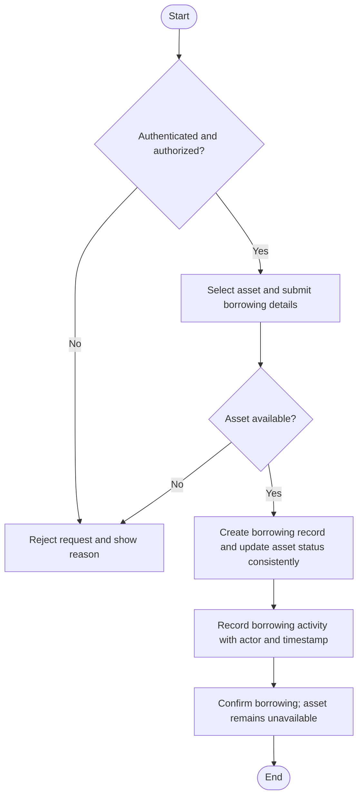
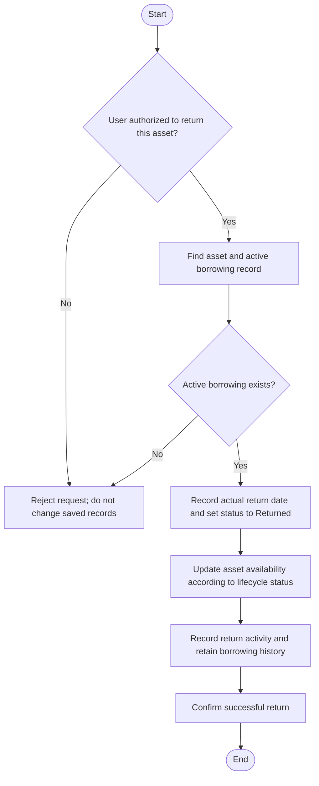
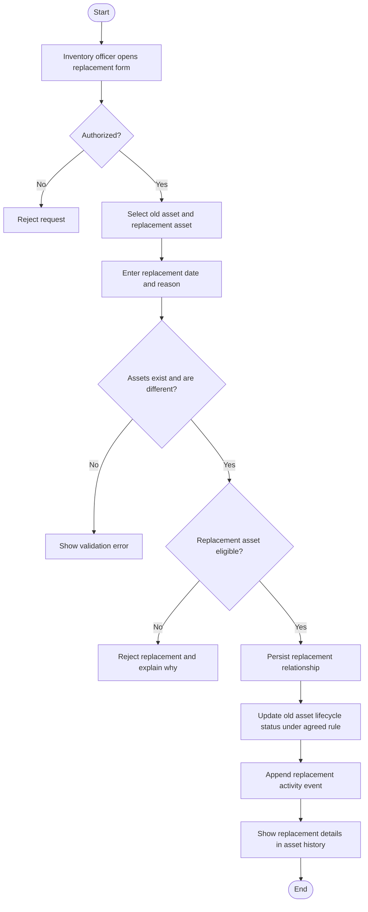
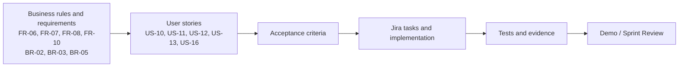

# StoreIT - Sprint 3 Requirements and Delivery Plan

> **Purpose.** This is a Sprint 3 supplement to `StoreIT-All.md`. It preserves the existing product backlog IDs and requirement terminology, and adds Sprint 3 acceptance criteria, Jira task suggestions, requirement diagrams, a report-ready version, and a cautious Sprint 4 proposal.
>
> **Planning baseline.** Sprint 3 is planned for two weeks. The selected scope is Epic 3 (Asset Borrowing: US-10, US-11, US-12) and Epic 4 (Asset Lifecycle and Activity: US-13, US-16), for an initial estimate of **28 story points**. Estimates must be confirmed by the team during Sprint Planning.

## 1. Sprint 3 - Markdown / Jira planning version

### 1.1 Sprint information

| Item | Value |
| --- | --- |
| Sprint | Sprint 3 |
| Duration | 2 weeks |
| Status | Planned - update from Jira after the Sprint starts |
| Sprint Goal | Enable employees to borrow and return assets with consistent availability and traceable borrowing records, while allowing authorized users to track asset replacement and asset activity history. |
| Selected scope | Epic 3 - Asset Borrowing; Epic 4 - Asset Lifecycle and Activity |
| Planned estimate | 28 story points, subject to team confirmation |

### 1.2 Selected Product Backlog Items

| ID | User Story | Related requirement | Estimate | Dependency / planning note |
| --- | --- | --- | ---: | --- |
| US-10 | Borrow an asset | FR-06 | 8 | Foundation for US-11 and US-12 |
| US-11 | Return an asset | FR-07 | 5 | Depends on a recorded borrowing transaction (US-10) |
| US-12 | View borrowing/history information | FR-07, FR-10 | 5 | Depends on borrowing and return records (US-10, US-11) |
| US-13 | Record asset replacement | FR-08 | 5 | Integrate with asset status and history |
| US-16 | View asset activity history | FR-10 | 5 | Should show key events, including borrowing, return, and replacement |
| **Total** | **5 stories** |  | **28** | **Team to validate capacity and estimates** |

### 1.3 Sprint scope and business rules

**In-scope in Sprint 3**

- Borrow an asset that is available for internal use.
- Record the borrower, asset, borrowing date, optional expected return date, and transaction status.
- Return a borrowed asset, update its availability, and preserve the borrowing record.
- View borrowing/return records and identify who borrowed an asset.
- Record the relationship between an old asset and its replacement, including date and reason.
- View a chronological history of important asset activities.

**Out-of-Scope, based on Developer ability**

- Email, SMS, or push notifications for due or overdue returns.
- External/public lending, procurement, accounting, mobile applications, or hardware/QR integration.
- Advanced analytics or a new reporting subsystem.
- Any automatic deletion of historical borrowing or lifecycle records.

**Rules carried forward from the product baseline**

- **BR-02 - Asset Availability:** an unavailable or already-borrowed asset must not be borrowed again.
- **BR-03 - Permission Enforcement:** users can perform only the operations permitted by their roles.
- **BR-05 - Lifecycle Traceability:** important lifecycle changes must remain traceable rather than being silently overwritten.
- **NFR-03 - Reliability:** valid asset and borrowing records must not be lost or corrupted during normal operations.
- **NFR-04 - Security:** protected operations and data must be accessible only to authorized users.

### 1.4 Acceptance criteria

These criteria are proposed refinements of the existing Product Backlog. Confirm them with the team before marking each story as Ready in Jira.

#### US-10 - Borrow an asset

> As an employee, I want to borrow an available asset so that I can use the asset for my internal work.

| ID | Acceptance criterion |
| --- | --- |
| US10-AC1 | Given an authenticated user with borrowing permission, when the user opens the asset catalogue, the system shows assets available for borrowing according to the user's permissions. |
| US10-AC2 | Given an available asset, when the employee submits a valid borrowing request, the system creates a borrowing record containing the borrower, asset, borrowing date, optional expected return date, and borrowing status. |
| US10-AC3 | When a borrowing request succeeds, the asset's status/availability is updated so that it cannot be borrowed again while the current borrowing remains active. |
| US10-AC4 | Given an unavailable, already-borrowed, retired, or replaced asset, when a user attempts to borrow it, the system rejects the request and explains that the asset is unavailable. |
| US10-AC5 | Given two requests for the same asset arrive before either user sees the updated screen, the system must not create two active borrowing records for that asset. |
| US10-AC6 | If a borrowing request fails, the system must not leave a partial result such as an active borrowing record without the corresponding asset-status update. |
| US10-AC7 | A successful borrowing is available for later review in the borrowing records and asset activity history. |

#### US-11 - Return an asset

> As an employee, I want to return a borrowed asset so that it becomes available for future use.

| ID | Acceptance criterion |
| --- | --- |
| US11-AC1 | An authorized user can find a currently borrowed asset and initiate its return. The exact permission rule (borrower only, inventory officer, or both) must follow the agreed permission matrix. |
| US11-AC2 | The system allows a return only when a corresponding active borrowing record exists. |
| US11-AC3 | On successful return, the system records the actual return date and changes the borrowing status to Returned. |
| US11-AC4 | The asset becomes available for future borrowing after a valid return, provided no other lifecycle status prevents it from being available. |
| US11-AC5 | The original borrowing record remains available after return; it is not deleted or overwritten. |
| US11-AC6 | A successful return appears in the borrowing history and the asset activity history. |
| US11-AC7 | An invalid or repeated return request is rejected without corrupting the existing borrowing record or asset status. |

#### US-12 - View borrowing/history information

> As an inventory officer, I want to view borrowing and return history so that I can track how assets are being used and who has borrowed them.

| ID | Acceptance criterion |
| --- | --- |
| US12-AC1 | An authorized user can open a borrowing-history view. |
| US12-AC2 | Each record displays, where applicable, the asset, borrower, borrowing date, expected return date, actual return date, and current borrowing status. |
| US12-AC3 | The user can distinguish active borrowings from returned borrowings. |
| US12-AC4 | The borrowing record remains visible after the asset has been returned. |
| US12-AC5 | Users without permission cannot access borrowing records through either the user interface or a direct backend/API request. |

#### US-13 - Record asset replacement

> As an inventory officer, I want to record an asset replacement so that the relationship between the old and new assets remains traceable.

| ID | Acceptance criterion |
| --- | --- |
| US13-AC1 | An authorized inventory officer can select the old asset and the replacement asset and enter the replacement date and reason. |
| US13-AC2 | The system rejects a replacement if the old and new asset refer to the same asset or if either asset does not exist. |
| US13-AC3 | The system validates that the replacement asset is in a state eligible for replacement use. The exact eligible statuses must be agreed before implementation. |
| US13-AC4 | On success, the system preserves the old-to-new asset relationship and the replacement date and reason. |
| US13-AC5 | The old asset's resulting status is updated according to the agreed lifecycle rule; its historical record is retained. |
| US13-AC6 | The replacement can be discovered from the old asset's details/history and, where practical, from the replacement asset's details/history. |
| US13-AC7 | An activity-history event is recorded for the replacement, including the acting user and timestamp. |

#### US-16 - View asset activity history

> As an authorized user, I want to view an asset's activity history so that I can understand the important changes that have occurred throughout its lifecycle.

| ID | Acceptance criterion |
| --- | --- |
| US16-AC1 | An authorized user can open an asset and view its activity history in chronological order. |
| US16-AC2 | The history includes applicable key events: asset creation, update, retirement/removal, borrowing, return, and replacement. |
| US16-AC3 | Each applicable event identifies the action, acting user, and timestamp. |
| US16-AC4 | Borrowing, return, and replacement events correspond to the actual persisted business records; the history must not show a successful event for a failed transaction. |
| US16-AC5 | Historical events remain available after subsequent changes to the asset. |
| US16-AC6 | A user without the required permission cannot access protected activity-history data. |

### 1.5 Requirement diagrams

#### Figure 1 - Borrowing workflow

#### Figure 2 - Return workflow

**Note** Availability checking, creation of a borrowing record, and changing asset status must behave as one consistent transaction. Return does not delete the borrowing record; it closes the active borrowing and preserves the history.

#### Figure 3 - Asset replacement workflow

**Note** Should agree on which old-asset and replacement-asset statuses are allowed before implementation.

#### Figure 4 - Requirement traceability

### 1.6 Suggested Jira task

#### US-10 - Borrow an asset

| ID | Suggested Jira task |
| --- | --- |
| US10-T1 | Define borrowing statuses and the rules for eligible assets |
| US10-T2 | Design borrowing-record data model and asset relationship |
| US10-T3 | Implement borrowing form and validation |
| US10-T4 | Implement backend borrowing logic and enforce availability checks |
| US10-T5 | Ensure borrowing-record creation and asset-status update are consistent/atomic |
| US10-T6 | Integrate role/permission checks and activity-history event creation |
| US10-T7 | Test successful, invalid, unavailable, repeated, and competing borrowing requests |

#### US-11 - Return an asset

| ID | Suggested Jira task |
| --- | --- |
| US11-T1 | Define who is allowed to return an asset in the permission matrix |
| US11-T2 | Implement return action for an active borrowing record |
| US11-T3 | Record actual return date and update borrowing status |
| US11-T4 | Update asset availability consistently and preserve the borrowing record |
| US11-T5 | Integrate activity history and test valid/invalid/repeated return cases |

#### US-12 - View borrowing/history information

| ID | Suggested Jira task |
| --- | --- |
| US12-T1 | Design borrowing-history list and record details |
| US12-T2 | Implement retrieval of borrowing and return records |
| US12-T3 | Display borrower, asset, dates, and borrowing status |
| US12-T4 | Apply permission checks to the view and backend/API |
| US12-T5 | Test history before and after asset return |

#### US-13 - Record asset replacement

| ID | Suggested Jira task |
| --- | --- |
| US13-T1 | Agree on valid replacement states and lifecycle status transitions |
| US13-T2 | Design replacement relationship/data model |
| US13-T3 | Implement replacement form with date and reason |
| US13-T4 | Implement validation and save replacement relationship |
| US13-T5 | Update lifecycle status and append replacement activity event |
| US13-T6 | Test invalid assets, same-asset selection, permissions, and traceability |

#### US-16 - View asset activity history

| ID | Suggested Jira task |
| --- | --- |
| US16-T1 | Define the common activity-event fields and supported event types |
| US16-T2 | Implement/reuse activity logging for asset changes, borrowing, return, and replacement |
| US16-T3 | Implement chronological activity-history retrieval |
| US16-T4 | Display action, acting user, and timestamp with appropriate access control |
| US16-T5 | Test event accuracy, ordering, persistence, and permission enforcement |

### 1.7 Dependencies, risks, and mitigations

| Risk / dependency | Impact | Mitigation / action |
| --- | --- | --- |
| US-11 and US-12 depend on correct borrowing records from US-10 | Return/history work may be blocked by an unstable data model | Agree on the borrowing data model and statuses first; implement US-10 before integrating US-11 and US-12 |
| Two users attempt to borrow the same asset at nearly the same time | Duplicate active borrowing or inconsistent asset status | Enforce availability on the backend and make the record/status update atomic; test competing requests |
| US-12 and US-16 could duplicate or disagree about history | Confusing user experience and inconsistent evidence | Define the distinction: US-12 is transaction-oriented borrowing/return history; US-16 is the broader asset-lifecycle timeline. Both should reference consistent persisted events |
| Asset replacement status rules are underspecified | Old/new assets could end in contradictory states | Approve eligible statuses and transitions during backlog refinement before coding |
| Role permissions differ across borrowing, returns, replacement, and history | Unauthorized operations or blocked legitimate workflows | Confirm a single permission matrix and test backend as well as frontend enforcement |
| Sprint contains five stories with dependencies | Integration and testing may be squeezed at the end | Integrate continuously, test each vertical workflow, and re-evaluate capacity during Sprint Planning |

### 1.8 Definition of Done

Use the project's existing Definition of Done. A story is Done only when:

- Its agreed acceptance criteria are satisfied.
- The implementation is integrated into the current product.
- Relevant tests pass.
- No known critical or blocking defects remain.
- The team has reviewed the feature.
- The feature is usable in the project environment.
- The required project documentation and Jira status are updated.

### 1.9 Planned Increment

...

### 1.10 Other questions (can be used to building quality check)

1. **Return permissions:** may only the borrower return an asset, may an Inventory Officer return it, or are both allowed?
2. **Replacement policy:** which statuses are allowed for the old and replacement assets, and what status should the old asset receive after replacement?
3. **History scope:** is the activity timeline visible to Inventory Officers only, or to other authorized roles as well?
4. **Expected return date:** is it optional as in the current FR-06 wording, and what validation applies if entered?
5. **Transaction consistency:** confirm that asset availability and borrowing-record status must never contradict one another