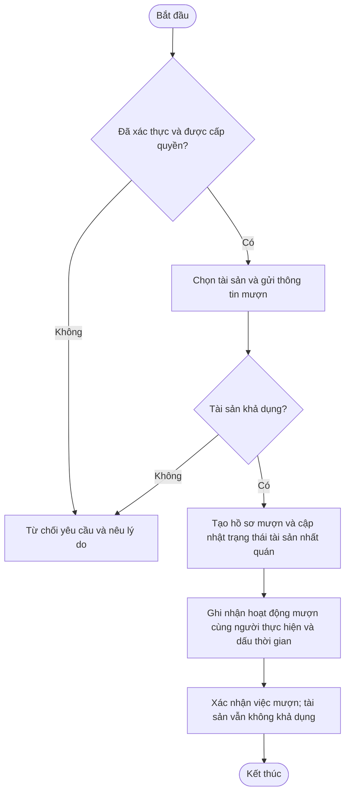
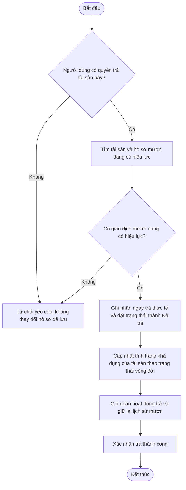
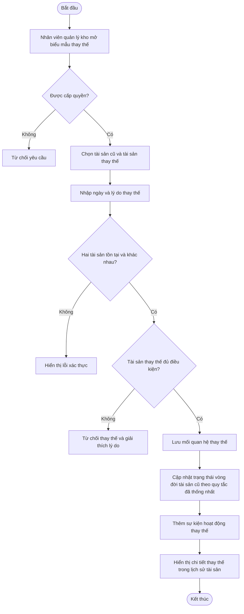
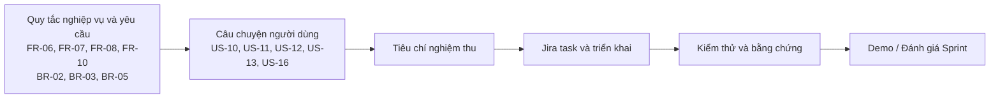

# StoreIT - Yêu cầu và Kế hoạch Bàn giao Sprint 3

> **Mục đích.** Đây là tài liệu bổ sung cho Sprint 3 của `StoreIT-All.md`. Tài liệu giữ nguyên các mã Product Backlog và thuật ngữ yêu cầu hiện có, đồng thời bổ sung tiêu chí nghiệm thu của Sprint 3, các đề xuất Jira task, sơ đồ yêu cầu, phiên bản sẵn sàng đưa vào báo cáo và một đề xuất thận trọng cho Sprint 4.
>
> **Cơ sở lập kế hoạch.** Sprint 3 được lên kế hoạch kéo dài hai tuần. Phạm vi được chọn gồm Epic 3 (Mượn tài sản: US-10, US-11, US-12) và Epic 4 (Vòng đời và hoạt động của tài sản: US-13, US-16), với ước lượng ban đầu là **28 story point**. Nhóm phải xác nhận lại các ước lượng trong buổi Lập kế hoạch Sprint (Sprint Planning).

## 1. Sprint 3 - Phiên bản Markdown / lập kế hoạch trên Jira

### 1.1 Thông tin Sprint

| Hạng mục | Giá trị |
| --- | --- |
| Sprint | Sprint 3 |
| Thời lượng | 2 tuần |
| Trạng thái | Đã lên kế hoạch - cập nhật từ Jira sau khi Sprint bắt đầu |
| Mục tiêu Sprint | Cho phép nhân viên mượn và trả tài sản với trạng thái khả dụng nhất quán và hồ sơ mượn có thể truy vết, đồng thời cho phép người dùng được cấp quyền theo dõi việc thay thế tài sản và lịch sử hoạt động của tài sản. |
| Phạm vi được chọn | Epic 3 - Mượn tài sản; Epic 4 - Vòng đời và hoạt động của tài sản |
| Ước lượng dự kiến | 28 story point, tùy thuộc vào xác nhận của nhóm |

### 1.2 Các Product Backlog được chọn

| ID | Câu chuyện người dùng (User Story) | Yêu cầu liên quan | Ước lượng | Phụ thuộc / ghi chú lập kế hoạch |
| --- | --- | --- | ---: | --- |
| US-10 | Mượn một tài sản | FR-06 | 8 | Là nền tảng cho US-11 và US-12 |
| US-11 | Trả một tài sản | FR-07 | 5 | Phụ thuộc vào một giao dịch mượn đã được ghi nhận (US-10) |
| US-12 | Xem thông tin/lịch sử mượn | FR-07, FR-10 | 5 | Phụ thuộc vào hồ sơ mượn và trả (US-10, US-11) |
| US-13 | Ghi nhận việc thay thế tài sản | FR-08 | 5 | Tích hợp với trạng thái và lịch sử tài sản |
| US-16 | Xem lịch sử hoạt động của tài sản | FR-10 | 5 | Nên hiển thị các sự kiện quan trọng, bao gồm mượn, trả và thay thế |
| **Tổng** | **5 câu chuyện** |  | **28** | **Nhóm cần xác nhận năng lực thực hiện và các ước lượng** |

### 1.3 Phạm vi Sprint và quy tắc nghiệp vụ

**In-scope Sprint 3**

- Mượn một tài sản đang khả dụng để sử dụng nội bộ.
- Ghi nhận người mượn, tài sản, ngày mượn, ngày dự kiến trả nếu có và trạng thái giao dịch.
- Trả tài sản đã mượn, cập nhật trạng thái khả dụng và bảo toàn hồ sơ mượn.
- Xem hồ sơ mượn/trả và xác định ai đã mượn một tài sản.
- Ghi nhận mối quan hệ giữa tài sản cũ và tài sản thay thế, bao gồm ngày và lý do thay thế.
- Xem lịch sử theo trình tự thời gian của các hoạt động quan trọng liên quan đến tài sản.

**Out-of-Scope, tuỳ thuộc lựa chọn của Developer**

- Thông báo qua email, SMS hoặc thông báo đẩy về việc đến hạn hoặc quá hạn trả tài sản.
- Cho mượn bên ngoài/công khai, mua sắm, kế toán, ứng dụng di động hoặc tích hợp phần cứng/QR.
- Phân tích nâng cao hoặc một hệ thống con báo cáo mới.
- Bất kỳ hành vi tự động xóa nào đối với hồ sơ mượn hoặc hồ sơ vòng đời trong quá khứ.

**Các quy tắc được kế thừa từ cơ sở sản phẩm**

- **BR-02 - Trạng thái khả dụng của tài sản:** tài sản không khả dụng hoặc đã được mượn không được phép cho mượn lần nữa.
- **BR-03 - Thực thi quyền hạn:** người dùng chỉ được thực hiện những thao tác được vai trò của họ cho phép.
- **BR-05 - Khả năng truy vết vòng đời:** những thay đổi quan trọng trong vòng đời phải tiếp tục có thể truy vết, thay vì bị ghi đè mà không lưu dấu vết.
- **NFR-03 - Độ tin cậy:** hồ sơ tài sản và hồ sơ mượn hợp lệ không được bị mất hoặc hỏng trong quá trình vận hành bình thường.
- **NFR-04 - Bảo mật:** chỉ người dùng được cấp quyền mới được truy cập các thao tác và dữ liệu được bảo vệ.

### 1.4 Tiêu chí nghiệm thu (Acceptance criteria)

#### US-10 - Borrow an asset

> Với tư cách là một nhân viên, tôi muốn mượn một tài sản đang khả dụng để có thể sử dụng tài sản đó cho công việc nội bộ của mình.

| ID | Tiêu chí nghiệm thu |
| --- | --- |
| US10-AC1 | Với điều kiện người dùng đã xác thực và có quyền mượn, khi người dùng mở danh mục tài sản, hệ thống hiển thị những tài sản có thể cho mượn theo quyền của người dùng. |
| US10-AC2 | Với điều kiện tài sản đang khả dụng, khi nhân viên gửi một yêu cầu mượn hợp lệ, hệ thống tạo hồ sơ mượn có chứa người mượn, tài sản, ngày mượn, ngày dự kiến trả nếu có và trạng thái mượn. |
| US10-AC3 | Khi yêu cầu mượn thành công, trạng thái/tình trạng khả dụng của tài sản được cập nhật để tài sản không thể bị mượn lần nữa trong khi giao dịch mượn hiện tại vẫn đang có hiệu lực. |
| US10-AC4 | Với một tài sản không khả dụng, đã được mượn, đã ngừng sử dụng hoặc đã bị thay thế, khi người dùng cố mượn tài sản đó, hệ thống từ chối yêu cầu và giải thích rằng tài sản không khả dụng. |
| US10-AC5 | Với điều kiện có hai yêu cầu mượn cùng một tài sản đến trước khi một trong hai người dùng nhìn thấy màn hình đã cập nhật, hệ thống không được tạo hai hồ sơ mượn đang có hiệu lực cho tài sản đó. |
| US10-AC6 | Nếu yêu cầu mượn thất bại, hệ thống không được để lại kết quả dở dang, chẳng hạn hồ sơ mượn đang có hiệu lực nhưng trạng thái tài sản chưa được cập nhật tương ứng. |
| US10-AC7 | Một giao dịch mượn thành công có thể được tra cứu sau này trong hồ sơ mượn và lịch sử hoạt động của tài sản. |

#### US-11 - Return an asset

> Với tư cách là một nhân viên, tôi muốn trả tài sản đã mượn để tài sản đó có thể được sử dụng trong những lần mượn sau.

| ID | Tiêu chí nghiệm thu |
| --- | --- |
| US11-AC1 | Người dùng được cấp quyền có thể tìm một tài sản hiện đang được mượn và bắt đầu quy trình trả. Quy tắc quyền hạn cụ thể (chỉ người mượn, nhân viên quản lý kho, hay cả hai) phải tuân theo ma trận quyền đã thống nhất. |
| US11-AC2 | Hệ thống chỉ cho phép trả khi tồn tại hồ sơ mượn đang có hiệu lực tương ứng. |
| US11-AC3 | Khi việc trả thành công, hệ thống ghi nhận ngày trả thực tế và chuyển trạng thái giao dịch mượn thành Returned (Đã trả). |
| US11-AC4 | Sau khi trả hợp lệ, tài sản trở nên khả dụng cho các lần mượn sau, với điều kiện không có trạng thái vòng đời nào khác ngăn tài sản trở nên khả dụng. |
| US11-AC5 | Hồ sơ mượn ban đầu vẫn có thể được xem sau khi tài sản được trả; hồ sơ không bị xóa hoặc ghi đè. |
| US11-AC6 | Một lần trả thành công xuất hiện trong lịch sử mượn và lịch sử hoạt động của tài sản. |
| US11-AC7 | Yêu cầu trả không hợp lệ hoặc yêu cầu trả lặp lại sẽ bị từ chối mà không làm hỏng hồ sơ mượn hoặc trạng thái tài sản hiện có. |

#### US-12 - View borrowing/history information

> Với tư cách là một nhân viên quản lý kho, tôi muốn xem lịch sử mượn và trả để có thể theo dõi cách tài sản được sử dụng và ai đã mượn tài sản.

| ID | Tiêu chí nghiệm thu |
| --- | --- |
| US12-AC1 | Người dùng được cấp quyền có thể mở màn hình xem lịch sử mượn. |
| US12-AC2 | Mỗi hồ sơ hiển thị các thông tin phù hợp, gồm tài sản, người mượn, ngày mượn, ngày dự kiến trả, ngày trả thực tế và trạng thái mượn hiện tại. |
| US12-AC3 | Người dùng có thể phân biệt các giao dịch mượn đang có hiệu lực với các giao dịch đã trả. |
| US12-AC4 | Hồ sơ mượn vẫn hiển thị sau khi tài sản đã được trả. |
| US12-AC5 | Người dùng không có quyền không thể truy cập hồ sơ mượn thông qua giao diện người dùng hoặc yêu cầu trực tiếp đến backend/API. |

#### US-13 - Record asset replacement

> Với tư cách là một nhân viên quản lý kho, tôi muốn ghi nhận việc thay thế tài sản để mối quan hệ giữa tài sản cũ và tài sản mới vẫn có thể truy vết.

| ID | Tiêu chí nghiệm thu |
| --- | --- |
| US13-AC1 | Nhân viên quản lý kho được cấp quyền có thể chọn tài sản cũ và tài sản thay thế, đồng thời nhập ngày và lý do thay thế. |
| US13-AC2 | Hệ thống từ chối việc thay thế nếu tài sản cũ và tài sản mới là cùng một tài sản hoặc nếu một trong hai tài sản không tồn tại. |
| US13-AC3 | Hệ thống xác thực rằng tài sản thay thế đang ở trạng thái phù hợp để được sử dụng làm tài sản thay thế. Các trạng thái đủ điều kiện cụ thể phải được thống nhất trước khi triển khai. |
| US13-AC4 | Khi thao tác thành công, hệ thống bảo toàn mối quan hệ từ tài sản cũ đến tài sản mới, cùng ngày và lý do thay thế. |
| US13-AC5 | Trạng thái cuối cùng của tài sản cũ được cập nhật theo quy tắc vòng đời đã thống nhất; hồ sơ lịch sử của tài sản vẫn được giữ lại. |
| US13-AC6 | Có thể tra cứu việc thay thế từ chi tiết/lịch sử của tài sản cũ và, khi khả thi, từ chi tiết/lịch sử của tài sản thay thế. |
| US13-AC7 | Một sự kiện trong lịch sử hoạt động được ghi nhận cho việc thay thế, bao gồm người thực hiện và dấu thời gian. |

#### US-16 - View asset activity history

> Với tư cách là một người dùng được cấp quyền, tôi muốn xem lịch sử hoạt động của một tài sản để hiểu những thay đổi quan trọng đã diễn ra trong suốt vòng đời của tài sản đó.

| ID | Tiêu chí nghiệm thu |
| --- | --- |
| US16-AC1 | Người dùng được cấp quyền có thể mở một tài sản và xem lịch sử hoạt động của tài sản theo thứ tự thời gian. |
| US16-AC2 | Lịch sử bao gồm các sự kiện quan trọng có áp dụng: tạo tài sản, cập nhật, ngừng sử dụng/loại bỏ, mượn, trả và thay thế tài sản. |
| US16-AC3 | Mỗi sự kiện áp dụng xác định hành động, người thực hiện và dấu thời gian. |
| US16-AC4 | Các sự kiện mượn, trả và thay thế tương ứng với những hồ sơ nghiệp vụ thực sự đã được lưu; lịch sử không được hiển thị một sự kiện thành công cho một giao dịch thất bại. |
| US16-AC5 | Các sự kiện lịch sử vẫn có thể truy cập sau những thay đổi tiếp theo đối với tài sản. |
| US16-AC6 | Người dùng không có quyền cần thiết không thể truy cập dữ liệu lịch sử hoạt động được bảo vệ. |

### 1.5 Sơ đồ yêu cầu

#### Hình 1 - Workflow Borrow an asset

#### Hình 2 - Workflow Return an asset

**Note** Việc kiểm tra tình trạng khả dụng, tạo hồ sơ mượn và thay đổi trạng thái tài sản phải hoạt động như một giao dịch nhất quán. Việc trả tài sản không xóa hồ sơ mượn; thao tác này kết thúc giao dịch mượn đang có hiệu lực và bảo toàn lịch sử.

#### Hình 3 - Workflow Record asset replacement

**Note** Cần thống nhất những trạng thái nào được phép đối với tài sản cũ và tài sản thay thế trước khi triển khai.

#### Hình 4 - Truy vết yêu cầu

### 1.6 Đề xuất Jira task

#### US-10 - Borrow an asset

| ID | Jira task |
| --- | --- |
| US10-T1 | Xác định các trạng thái mượn và quy tắc xác định tài sản đủ điều kiện |
| US10-T2 | Thiết kế mô hình dữ liệu hồ sơ mượn và mối quan hệ với tài sản |
| US10-T3 | Triển khai biểu mẫu mượn và xác thực dữ liệu |
| US10-T4 | Triển khai logic mượn ở backend và thực thi kiểm tra tình trạng khả dụng |
| US10-T5 | Đảm bảo việc tạo hồ sơ mượn và cập nhật trạng thái tài sản nhất quán/nguyên tử |
| US10-T6 | Tích hợp kiểm tra vai trò/quyền hạn và tạo sự kiện trong lịch sử hoạt động |
| US10-T7 | Kiểm thử các yêu cầu mượn thành công, không hợp lệ, tài sản không khả dụng, yêu cầu lặp lại và các yêu cầu mượn cạnh tranh |

#### US-11 - Return an asset

| ID | Jira task |
| --- | --- |
| US11-T1 | Xác định ai được phép trả tài sản trong ma trận quyền hạn |
| US11-T2 | Triển khai thao tác trả cho một hồ sơ mượn đang có hiệu lực |
| US11-T3 | Ghi nhận ngày trả thực tế và cập nhật trạng thái mượn |
| US11-T4 | Cập nhật tình trạng khả dụng của tài sản một cách nhất quán và giữ lại hồ sơ mượn |
| US11-T5 | Tích hợp lịch sử hoạt động và kiểm thử các trường hợp trả hợp lệ/không hợp lệ/lặp lại |

#### US-12 - View borrowing/history information

| ID | Jira task |
| --- | --- |
| US12-T1 | Thiết kế danh sách lịch sử mượn và chi tiết hồ sơ |
| US12-T2 | Triển khai truy xuất hồ sơ mượn và trả |
| US12-T3 | Hiển thị người mượn, tài sản, ngày tháng và trạng thái mượn |
| US12-T4 | Áp dụng kiểm tra quyền hạn cho màn hình và backend/API |
| US12-T5 | Kiểm thử lịch sử trước và sau khi tài sản được trả |

#### US-13 - Record asset replacement

| ID | Jira task |
| --- | --- |
| US13-T1 | Thống nhất các trạng thái thay thế hợp lệ và quy tắc chuyển trạng thái vòng đời |
| US13-T2 | Thiết kế mô hình dữ liệu/mối quan hệ thay thế |
| US13-T3 | Triển khai biểu mẫu thay thế có ngày và lý do |
| US13-T4 | Triển khai xác thực và lưu mối quan hệ thay thế |
| US13-T5 | Cập nhật trạng thái vòng đời và thêm sự kiện hoạt động thay thế |
| US13-T6 | Kiểm thử tài sản không hợp lệ, chọn cùng một tài sản, quyền hạn và khả năng truy vết |

#### US-16 - View asset activity history

| ID | Jira task |
| --- | --- |
| US16-T1 | Xác định các trường chung của sự kiện hoạt động và các loại sự kiện được hỗ trợ |
| US16-T2 | Triển khai/tái sử dụng cơ chế ghi nhật ký hoạt động cho thay đổi tài sản, mượn, trả và thay thế |
| US16-T3 | Triển khai truy xuất lịch sử hoạt động theo thứ tự thời gian |
| US16-T4 | Hiển thị hành động, người thực hiện và dấu thời gian, kèm kiểm soát quyền truy cập phù hợp |
| US16-T5 | Kiểm thử tính chính xác, thứ tự, khả năng lưu giữ sự kiện và việc thực thi quyền hạn |

### 1.7 Các yếu tố phụ thuộc, rủi ro và biện pháp giảm thiểu

| Rủi ro / yếu tố phụ thuộc | Tác động | Biện pháp giảm thiểu / hành động |
| --- | --- | --- |
| US-11 và US-12 phụ thuộc vào hồ sơ mượn chính xác từ US-10 | Công việc trả/lịch sử có thể bị chặn bởi mô hình dữ liệu không ổn định | Thống nhất mô hình dữ liệu và trạng thái mượn trước; triển khai US-10 trước khi tích hợp US-11 và US-12 |
| Hai người dùng cố mượn cùng một tài sản gần như đồng thời | Có thể phát sinh hai giao dịch mượn đang hiệu lực hoặc trạng thái tài sản không nhất quán | Thực thi kiểm tra tình trạng khả dụng ở backend và cập nhật hồ sơ/trạng thái theo cách nguyên tử; kiểm thử các yêu cầu cạnh tranh |
| US-12 và US-16 có thể ghi nhận lịch sử trùng lặp hoặc không thống nhất | Trải nghiệm người dùng khó hiểu và bằng chứng không nhất quán | Xác định rõ sự khác biệt: US-12 tập trung vào lịch sử giao dịch mượn/trả; US-16 là dòng thời gian rộng hơn về vòng đời tài sản. Cả hai cần tham chiếu đến các sự kiện đã lưu nhất quán |
| Quy tắc trạng thái khi thay thế tài sản chưa được quy định đầy đủ | Tài sản cũ/mới có thể rơi vào các trạng thái mâu thuẫn | Phê duyệt các trạng thái đủ điều kiện và quy tắc chuyển trạng thái trong quá trình tinh chỉnh Product Backlog trước khi lập trình |
| Quyền hạn khác nhau giữa mượn, trả, thay thế và xem lịch sử | Có thể xảy ra thao tác trái phép hoặc quy trình hợp lệ bị chặn | Xác nhận một ma trận quyền hạn thống nhất và kiểm thử việc thực thi quyền ở cả backend lẫn frontend |
| Sprint có năm câu chuyện với các yếu tố phụ thuộc | Công việc tích hợp và kiểm thử có thể bị dồn vào cuối Sprint | Tích hợp liên tục, kiểm thử từng luồng nghiệp vụ hoàn chỉnh và đánh giá lại năng lực thực hiện trong Sprint Planning |

### 1.8 Định nghĩa Hoàn thành (Definition of Done)

Sử dụng Definition of Done hiện có của dự án. Một câu chuyện chỉ được xem là Hoàn thành khi:

- Các tiêu chí nghiệm thu đã thống nhất đều được đáp ứng.
- Phần triển khai đã được tích hợp vào sản phẩm hiện tại.
- Các kiểm thử liên quan đều đạt.
- Không còn lỗi nghiêm trọng hoặc lỗi chặn đã biết.
- Tính năng đã được nhóm đánh giá.
- Tính năng có thể sử dụng trong môi trường dự án.
- Tài liệu dự án cần thiết và trạng thái Jira đã được cập nhật.

### 1.9 Increment dự kiến

...

### 1.10 Câu hỏi khác (dùng để tạo quality check cũng oke)

1. **Quyền trả tài sản:** chỉ người mượn mới được trả tài sản, nhân viên quản lý kho cũng được trả, hay cả hai đều được phép?
2. **Chính sách thay thế:** những trạng thái nào được chấp nhận đối với tài sản cũ và tài sản thay thế, và tài sản cũ sẽ nhận trạng thái nào sau khi được thay thế?
3. **Phạm vi lịch sử:** dòng thời gian hoạt động chỉ hiển thị với nhân viên quản lý kho hay với cả các vai trò được cấp quyền khác?
4. **Ngày dự kiến trả:** trường này có tùy chọn hay không như cách diễn đạt hiện tại của FR-06, và nếu được nhập thì cần áp dụng quy tắc xác thực nào?
5. **Tính nhất quán giao dịch:** xác nhận rằng tình trạng khả dụng của tài sản và trạng thái hồ sơ mượn không bao giờ được mâu thuẫn với nhau.
